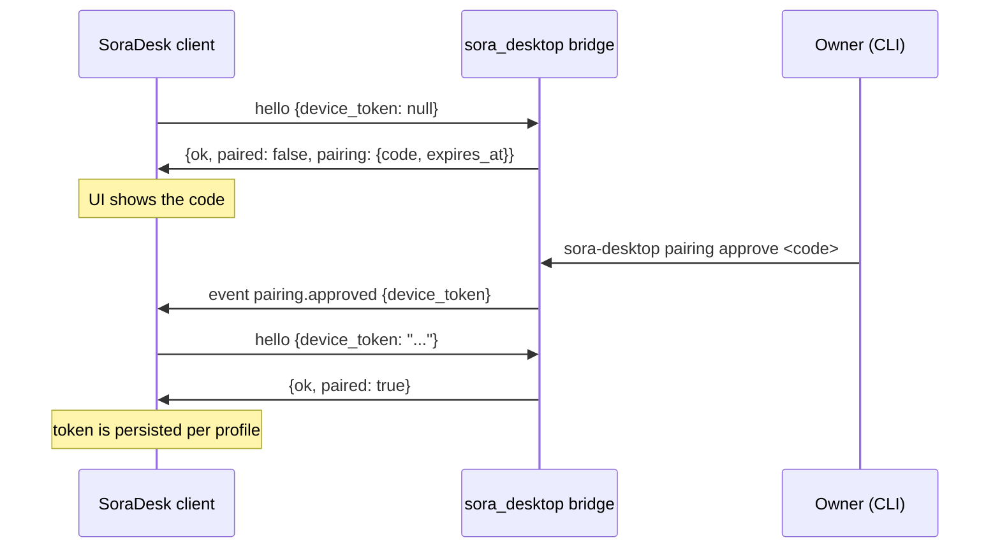

# SoraDesk ⇄ SoraAgent bridge protocol — v1 (FROZEN)

> **Status:** frozen. This document is the contract between the SoraDesk client and the
> `sora_desktop` bridge (`bridge/sora_desktop/` in this repository), which exposes a local
> SoraAgent runtime over a WebSocket.
> Any change to a frame's *meaning* requires a version bump. Additive fields and new event
> types do **not**.
>
> Reference implementation of the **server** side for development and conformance testing:
> [`dev/mock-gateway.mjs`](../dev/mock-gateway.mjs) (implements everything below; exercised by
> [`dev/smoke.mjs`](../dev/smoke.mjs)). The real bridge is exercised by
> [`bridge/tests/smoke.py`](../bridge/tests/smoke.py).

## 1. Envelope and transport

- One multiplexed **WebSocket** connection carries everything. All three connection modes
  (local / SSH tunnel / direct IP) are *the same protocol* — see
  [`connections.md`](./connections.md).
- Frames are **JSON objects in WebSocket text frames**, UTF-8. Binary frames are unused in v1.
- Every frame carries `"v": 1` (integer). It is the only version marker.
- Unknown fields **must be ignored** by both sides.

Three frame shapes:

| Direction | Shape |
|---|---|
| client → server request | `{"v": 1, "id": "<string>", "type": "<request>", ...params}` |
| server → client response | `{"v": 1, "id": "<same id>", "ok": true, "result": {...}}` or `{"v": 1, "id": "<same id>", "ok": false, "error": {"code": "...", "message": "..."}}` |
| server → client event (no `id`) | `{"v": 1, "type": "<event>", "event": {...}}` |

- `id` is a client-generated string (UUID v4 recommended). Responses echo it.
- A response is exactly one of `result` (when `ok: true`) or `error` (when `ok: false`).
- Clients **must** ignore unknown event types (forward compatibility). Servers reply with
  error code `unsupported` to unknown request types.

## 2. Session states and authentication

A connection moves through: `connecting → hello → paired → active`.

- The **first frame** the client sends must be a `hello` request. Before a successful
  `hello`, every request other than `ping` fails with error code `not_paired`.
  If no `hello` arrives within **10 s**, the server closes with WS close code **4408**.
- Device authorization uses the bridge's local pairing ledger
  (`~/.sora_agent/desktop/pairing.json`). Flow:



- If the client presents a valid token: response is `ok: true` with `paired: true`.
  The server may **rotate** the token; the client always replaces its stored token with
  `result.device_token` when present.
- If the token is missing, unknown, or revoked: response is `ok: true` with `paired: false`
  and a fresh `pairing` object (`reason` explains why re-pairing is needed: `"missing"`,
  `"unknown"`, or `"revoked"`). After approval the server pushes `pairing.approved`; the
  client then sends `hello` again with the new token.
- If the token is revoked **while connected**, the server sends `error`
  code `unauthorized` and/or closes with WS close code **4401**. The client must not
  auto-reconnect in that case; it returns to the pairing UI.
- A server may be configured to trust loopback connections (`trust_localhost` in the bridge
  config); those then get `paired: true` directly. This is a *server-side policy* and does not
  change any frame.
- `hello.result` may carry `limits: {"max_upload_bytes": <int>, "max_fetch_bytes": <int>}`
  (§3.1, §3.2). It is additive: a client that does not see it must fall back to its own default.
  `max_fetch_bytes` is present **only** when the bridge understands `media.fetch` — its absence
  is the client's feature detection. The object is sent on both the paired and the
  `paired: false` branch, so a client knows its budget before it is approved.
- `hello.result.features` is an optional array of additive request frames the bridge
  understands. The SoraAgent bridge advertises `[]`: SoraAgent has no mid-turn steering, so
  text typed while a turn runs is queued client-side. Treat an absent/empty list as "none of
  them".
- **Protocol mismatch**: if the first frame's `v` is unsupported, the server responds
  `{ok: false, error: {code: "protocol_mismatch"}}` and closes with 4400.

### Timestamps

All `*_at` / `ts` fields minted by this protocol are **Unix epoch milliseconds (integer)**.
Two read-only results pass SoraAgent values through: `calendar.list` carries SoraAgent's
ISO-8601 strings, and `memory.stats` carries the bytes/counts from `memory.doctor()`.

## 3. Requests (client → server)

| `type` | params | `result` |
|---|---|---|
| `hello` | `device_token: string \| null`, `client: {name, version, platform?}` | see §2 |
| `chat.send` | `session_id: string \| null`, `text: string`, `attachments?: string[]` (attachment ids, §3.1) | `{session_id, turn_id}` |
| `media.upload` | `name: string`, `mime: string`, `kind: "image" \| "audio" \| "video" \| "file"`, `data: string` (base64), `duration_ms?: number` | `{attachment_id, name, mime, kind, size, duration_ms?}` (§3.1) |
| `media.fetch` | `session_id: string`, `attachment_id: string` | `{attachment_id, name, mime, kind, size, duration_ms?, data}` (§3.2) |
| `turn.interrupt` | `session_id`, `turn_id` | `{interrupted: boolean}` |
| `sessions.list` | `limit?: number` (default 50), `cursor?: string` | `{sessions: [SessionMeta], next_cursor?}` |
| `sessions.history` | `session_id`, `limit?: number` (default 100), `before?: string` (opaque cursor) | `{session_id, messages: [HistoryMessage], next_cursor?}` |
| `memory.stats` | — | `MemoryStats` (§5) |
| `calendar.list` | `limit?: number` (default 200, capped at 500) | `{items: [CalendarItem], enabled, error?}` |
| `approve` | `approval_id` | `{approval_id, approved: true}` |
| `deny` | `approval_id`, `reason?: string` | `{approval_id, approved: false}` |
| `ping` | `ts` (client epoch ms) | `{ts, server_time}` |

Rules:

- `chat.send` with `session_id: null` creates a new session; the result reports its id.
- At most one active turn per session. `chat.send` while a turn is running for that session
  fails with `busy`. A rejected send consumes nothing: its attachments stay usable for the
  retry, and no turn starts.
- `ping` is accepted without pairing and should be answered even while `hello` is pending.
  The client sends it every 30 s of idleness and treats two unanswered pings as a dead
  connection.
- `chat.send` requires `text` to be non-empty unless it carries at least one `attachments` id.

### `SessionMeta`

```json
{
  "id": "s-17f2",
  "title": "Refactor the pairing store",
  "created_at": 1760000000000,
  "updated_at": 1760000300000,
  "message_count": 24,
  "source": "desktop"
}
```

### 3.1 Attachments (additive)

Media (photos, voice notes, audio, video, arbitrary files) is uploaded first and then
referenced by id from `chat.send`. Both steps are ordinary requests on the same connection;
there is no separate channel and no binary frame type.

```
client → server   {"v":1,"id":"u1","type":"media.upload",
                   "name":"photo.jpg","mime":"image/jpeg","kind":"image",
                   "data":"<base64>","duration_ms":4200}
server → client   {"v":1,"id":"u1","ok":true,
                   "result":{"attachment_id":"att-9f2c","name":"photo.jpg",
                             "mime":"image/jpeg","kind":"image","size":184233}}

client → server   {"v":1,"id":"c1","type":"chat.send","session_id":null,
                   "text":"what is this?","attachments":["att-9f2c"]}
server → client   {"v":1,"type":"message","event":{"session_id":"s-17f2",
                   "turn_id":"turn-…","message_id":"msg-…","role":"user",
                   "text":"what is this?","ts":1760000000000,
                   "attachments":[{"attachment_id":"att-9f2c","name":"photo.jpg",
                                    "mime":"image/jpeg","kind":"image","size":184233}]}}
```

Rules:

- `data` is standard base64 (no `data:` prefix, no whitespace). The server decodes it and
  reports the decoded `size` in bytes.
- `kind` is client-declared: `image`, `audio`, `video`, or `file`. `duration_ms` is optional
  and only meaningful for `audio` / `video`; a server that stores it echoes it on the upload
  result, the user echo, and history records.
- Uploads are owned by the connection's device token and expire: the server may drop an
  attachment after it is consumed by a `chat.send`, after a TTL (15 minutes recommended), or
  when the connection closes. `attachment_id`s must not be reused across uploads.
- An upload that exceeds the advertised cap fails with `too_large`
  (`details.limit_bytes` carries the limit). See §8 for the cap and the frame size it implies;
  `hello.limits.max_upload_bytes` (§2) announces it so clients can pre-check.
- `chat.send` with an unknown, expired, or foreign `attachment_id` fails with
  `no_attachment`; the whole send is rejected (no partial turn).
- The user-turn `message` event echoes the accepted attachments so the client can render
  them without re-reading local state. Assistant messages carry no `attachments` field.
- `text` may be `""` when at least one attachment is present. The bridge turns the
  attachment set into model-facing content itself (SoraAgent's file understander transcribes
  audio when configured) and substitutes a short visible caption naming the files
  (`See attached: photo.jpg`), so the stored user message and session title are never empty.
- Servers must accept a `chat.send` without `attachments` exactly as before — the field is
  additive.

### 3.2 Fetching attachment bytes (`media.fetch`)

A reloaded transcript carries attachment records (§3.3) but no bytes. `media.fetch` asks the
bridge for the stored file of one record, so a client can render the thumbnail or player it
showed when the turn was live.

```
client → server   {"v":1,"id":"m1","type":"media.fetch",
                   "session_id":"s-17f2","attachment_id":"att-9f2c"}
server → client   {"v":1,"id":"m1","ok":true,
                   "result":{"attachment_id":"att-9f2c","name":"photo.jpg",
                             "mime":"image/jpeg","kind":"image","size":184233,
                             "duration_ms":4200,"data":"<base64 of the stored bytes>"}}
```

Rules:

- **Feature detection is `hello.limits.max_fetch_bytes`.** A bridge that never sent it does not
  implement this request; clients must then keep rendering metadata-only records. A client may
  also skip ids whose record `size` exceeds the advertised cap.
- **Whole file, one frame.** There is no range or seek support: an `<audio>` / `<video>` element
  built from these bytes plays but cannot seek. Media that needs seeking would require a
  different (HTTP) transport.
- **Transcript-scoped.** The id must be referenced by that session's stored transcript; the
  server never resolves a client-supplied path. Ids that are not referenced by the given session
  — including ids uploaded on the same connection but never sent — answer `no_attachment`.
- **Device-scoped, not session-scoped.** Any paired device may fetch media referenced by any
  session it can read; pairing is the trust boundary, as it is for `sessions.history`.
- **Immutable.** Bytes never change for an id, so clients may cache them for as long as they
  like; a `media_gone` / `too_large` answer is worth remembering per id too, so a transcript
  does not retry it on every render.
- **Retention.** Servers may prune stored files; a record whose file is missing answers
  `media_gone` and the client falls back to the metadata chip. A file beyond
  `limits.max_fetch_bytes` answers `too_large` with `details.limit_bytes`.

### 3.3 `HistoryMessage`

```json
{
  "message_id": "m-0042",
  "role": "assistant",
  "text": "Done — the store now revokes per sender.",
  "ts": 1760000300000,
  "reasoning": [{ "text": "Check is_approved call sites." }],
  "tools": [{ "name": "file_edit", "ok": true, "summary": "pairing/store.py" }],
  "file_edits": [{ "path": "sora/pairing/store.py", "ok": true }]
}
```

`role` is one of `user`, `assistant`, `system`. `reasoning`, `tools`, `file_edits` are
optional. Two more optional fields exist for long answers and for attachments:

- `continued: true` on an assistant entry means it continues the previous assistant entry
  (the model hit its output cap and the answer was resumed). Servers **hide** the internal
  prompt they used to resume, so the two entries are the only trace of it; clients render them
  as one answer (concatenate the texts) if they want a single box.
- `attachments: [{attachment_id, name, mime, kind, size, duration_ms?}]` on a user entry
  repeats the records the live echo carried (§3.1). `duration_ms` is omitted when unknown.
  Servers must keep model-facing placeholders (`[image: /abs/path]`, …) out of the returned
  `text` whenever records exist — a filesystem path is never user-visible.
- `message_count` in `SessionMeta` / `session.updated` counts the entries a client can see
  (hidden internal prompts and command turns excluded).

### 3.4 `calendar.list`

`calendar.list` is read-only: the agent owns SoraAgent's local calendar
(`~/.sora_agent/calendar.db` by default), and the client only displays it. The result
mirrors `sora_agent.calendar.CalendarItem`; `starts_at` / `ends_at` / `due_at` /
`created_at` / `updated_at` / `completed_at` are SoraAgent's ISO-8601 strings (empty when
unset).

```json
{
  "items": [
    {
      "id": 1,
      "kind": "event",
      "title": "Design review",
      "starts_at": "2026-11-10T09:00:00+00:00",
      "ends_at": "2026-11-10T10:00:00+00:00",
      "due_at": "",
      "notes": "Walk through pairing.",
      "importance": "important",
      "importance_rank": 3,
      "done": false,
      "created_at": "2026-11-08T12:00:00+00:00",
      "updated_at": "2026-11-09T08:00:00+00:00",
      "completed_at": ""
    }
  ],
  "enabled": true,
  "error": null
}
```

Rules:

- `enabled: false` means the local calendar is turned off (`SORA_CALENDAR=0`); `items` is
  then empty and `error` is null.
- A read failure returns `enabled: true`, an empty `items`, and a human-readable `error`; the
  request itself still succeeds.
- The default window is SoraAgent's: events in the next 30 days plus all to-dos (including
  completed ones). The client currently exposes no date-range filter.
- `kind` is `event` or `todo`; `importance` is `important`, `balanced`, or `not important`.

## 4. Events (server → client)

Events mirror SoraAgent's channel outbound hooks (`send`, `send_delta`,
`send_reasoning_delta`, `send_reasoning_end`, `send_file_edit_events`, tool/progress
callbacks, approvals). The bridge translates `ChatHandler`'s cumulative stream snapshots
into the incremental `delta` frames below.

| `type` | payload | notes |
|---|---|---|
| `pairing.approved` | `{device_token}` | see §2 |
| `pairing.denied` | `{reason?}` | re-pairing is required |
| `message` | `{session_id, turn_id, message_id, role, text, ts, attachments?, replaced?}` | a **complete** message; authoritative for its `message_id`. `attachments` only on the user echo (§3.1); `replaced: true` marks a discarded segment (see the streaming contract) |
| `delta` | `{session_id, turn_id, message_id, text_delta}` | streaming assistant text |
| `reasoning_delta` | `{session_id, turn_id, message_id, text_delta}` | streaming reasoning |
| `reasoning_end` | `{session_id, turn_id, message_id}` | flush/close the reasoning block |
| `tool` | `{session_id, turn_id, tool_call_id, name, phase, summary?, args_preview?, ok?}` | `phase`: `start` \| `end` \| `error` |
| `file_edit` | `{session_id, turn_id, path, phase, ok?, diff_preview?}` | `phase`: `start` \| `end` |
| `progress` | `{session_id, turn_id?, kind, text}` | ephemeral status line |
| `approval` | `{session_id, turn_id, approval_id, tool, summary, args_preview?, deadline?}` | server awaits `approve` / `deny` |
| `turn.end` | `{session_id, turn_id, status, error?}` | `status`: `completed` \| `interrupted` \| `error` |
| `session.updated` | `{session_id, title?, updated_at, message_count?}` | drives live session lists |

Streaming contract:

1. The server echoes each accepted `chat.send` as a `message` event with `role: "user"`
   before any assistant output for that turn. Clients may render it optimistically until
   the echo arrives, but the echo is authoritative.
2. The server MAY stream `delta` / `reasoning_delta` events for a message, and MUST finish
   with a `message` event carrying the final text. If it did not stream, a single `message`
   event is enough.
3. A client renders deltas optimistically and **replaces** the accumulated text when the
   final `message` for the same `message_id` arrives.
4. `turn.end` is always sent exactly once per turn, after all message events for it.
5. Event ordering within a session is guaranteed. Ordering *between* sessions is not.
6. The server MAY discard text it has already streamed (for example when a provider recovers
   mid-stream and the answer is regenerated). It then sends a `message` event for the same
   `message_id` with `text: ""` and `replaced: true`: clients drop what they rendered for that
   id and keep rendering into it. A replacement is not a new message — no additional
   `message_id` is minted for the discarded text.
7. Text typed while a turn runs is queued by the client and sent as the next `chat.send`
   after `turn.end`. SoraAgent has no mid-turn steering, and the bridge advertises no
   additive features (`hello.result.features` is `[]`).

## 5. `memory.stats` result

The result combines SoraAgent's `MemoryHook.doctor()` diagnostics with byte sizes measured by
the bridge.

```json
{
  "enabled": true,
  "root": "/Users/me/.sora_agent",
  "db_path": "/Users/me/.sora_agent/memory/cortexdb.db",
  "db_bytes": 376832,
  "daily": {
    "days": 12,
    "messages": 348,
    "oldest": "2026-10-28",
    "newest": "2026-11-09",
    "bytes": 65536
  },
  "backup": {
    "count": 5,
    "active": 1,
    "daily": 4,
    "bytes": 1048576,
    "latest": "active-2026-11-09.db"
  },
  "sidecar": {
    "enabled": true,
    "binary_present": true,
    "running": true,
    "healthy": true,
    "http_addr": "127.0.0.1:39211",
    "grpc_addr": "127.0.0.1:39212",
    "db_path": "/Users/me/.sora_agent/memory/cortexdb.db",
    "backup_dir": "/Users/me/.sora_agent/memory backup",
    "version": "2.139.1",
    "log": "/Users/me/.sora_agent/logs/cortexdb-grpc.log"
  },
  "config": {
    "recall_mode": "auto",
    "auto_dream": true,
    "scheduler_running": true,
    "dream_hour_utc": 3
  }
}
```

When memory is disabled (`SORA_MEMORY=0`), the same shape is returned with `enabled: false`
and zeroed/empty nested objects. A `doctor()` failure adds an `error` string and leaves the
other fields empty; the request still succeeds.

## 6. Errors and close codes

| `error.code` | meaning |
|---|---|
| `protocol_mismatch` | unsupported `v`; server closes 4400 |
| `unauthorized` | device token revoked; server may close 4401 |
| `not_paired` | request before a successful `hello` |
| `bad_request` | malformed params for a known request |
| `unsupported` | unknown request type |
| `busy` | a turn is already running for that session |
| `no_session` / `no_turn` / `no_approval` / `no_attachment` | referenced id is unknown |
| `media_gone` | the attachment record exists but its stored file is gone |
| `too_large` | upload (or fetched file) exceeds the advertised cap; `details.limit_bytes` |
| `rate_limited` | slow down |
| `internal` | server-side failure; `message` may be shown to the user |

Error payloads: `{"code": "...", "message": "<human readable>", "details"?: {...}}`.

WebSocket close codes: **4400** protocol error · **4401** unauthorized/revoked ·
**4408** hello timeout · **1011** internal.

## 7. Client reconnect policy

- On abnormal close (network loss, bridge restart): reconnect with exponential backoff,
  1 s → 30 s cap, with jitter. Keep the tunnel (SSH mode) alive across reconnects when its
  health check still passes.
- On `4401`: stop, clear nothing, and surface the revoked-token state; the user re-pairs.
- On `4400` / `protocol_mismatch`: stop and show an actionable error (client/server version
  mismatch).
- After any successful reconnect the client sends `hello` again — see `hello.ok` in §2.

## 8. Size limits and hygiene

- Recommended max text frame size: 1 MiB for ordinary frames. `args_preview` and
  `diff_preview` are truncated by the server (4 KiB recommended).
- `media.upload` frames are the one exception: servers must accept frames large enough for
  `maxUploadMb` of raw data (~4/3 of that in base64) and answer `too_large` beyond it. The
  recommended default cap is 25 MiB per upload.
- A frame beyond the transport's own maximum size is not a protocol error: the WebSocket closes
  with **1009** (message too big). Clients should pre-check against `hello.limits.max_upload_bytes`
  and surface a `too_large` reply rather than relying on the close.
- Servers must not require any frame that a v1 client does not send.

## 9. Change log

- **v1 (frozen 2026-10-13):** initial contract. Ten request types, twelve event types,
  pairing handshake, streaming, approvals, sessions/calendar/memory query frames.
- **v1.1 (additive, 2026-10-15):** `media.upload` request; optional `attachments` on
  `chat.send` and on the user-turn `message` event; `too_large` / `no_attachment` error
  codes. No existing frame changed meaning, so `"v"` stays `1`.
- **v1.2 (additive, 2026-10-15):** `hello.result.limits.max_upload_bytes`; `duration_ms` echoed
  by `media.upload` / the user echo / history records; `replaced: true` on a `message` event
  that discards an already-streamed segment; `continued: true` and `attachments` on history
  entries; internal recovery prompts hidden from history and from `message_count`. `"v"` stays
  `1`.
- **v1.3 (additive, 2026-10-15):** `media.fetch` request plus `hello.result.limits.max_fetch_bytes`
  and the `media_gone` error code, so a reloaded transcript can render attachment previews.
  `"v"` stays `1`.
- **v1.4 (additive, 2026-10-18):** `hello.result.features` and the `chat.inject` request, so a
  client can steer the turn that is already running. `"v"` stays `1`.
- **SoraDesk adaptation (2026-11-09):** the server is the local `sora_desktop` bridge. It
  advertises `features: []` (no steering), replaces `cron.list` with read-only
  `calendar.list`, and reports the SoraAgent memory doctor shape. No envelope or event meaning
  changed, so `"v"` stays `1`.

## 10. Implementation status (informative)

- **Client:** SoraDesk implements everything above and queues text while a turn runs. The
  bundled mock gateway ([`dev/mock-gateway.mjs`](../dev/mock-gateway.mjs)) is the reference
  server used by the Node smoke suite.
- **Server:** [`bridge/sora_desktop/`](../bridge/sora_desktop/) implements v1 through v1.3
  plus read-only `calendar.list` and the SoraAgent `memory.stats` shape. It runs SoraAgent's
  own `ChatHandler`, so approvals, history, tools, and streaming come from the same runtime
  the CLI uses. `chat.inject` is intentionally unsupported.
